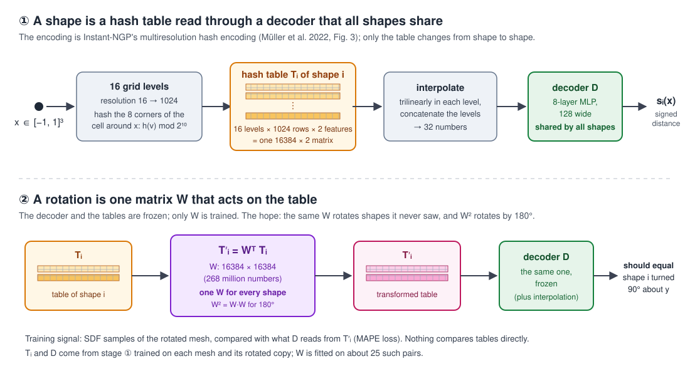
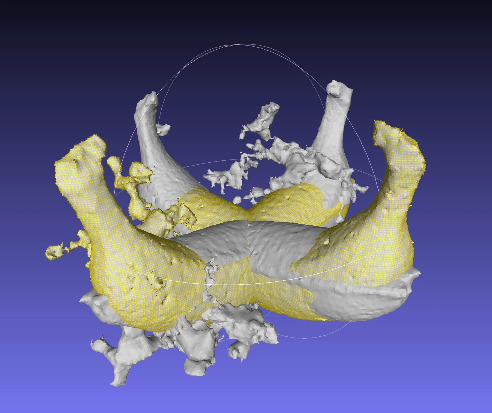
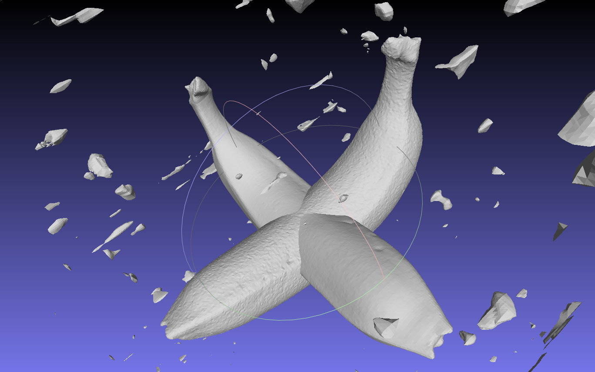
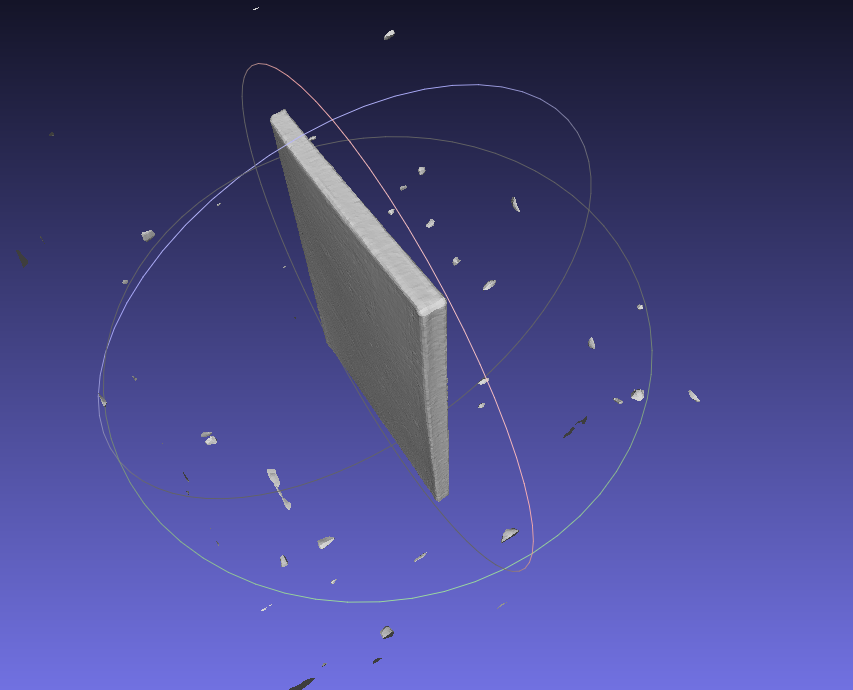
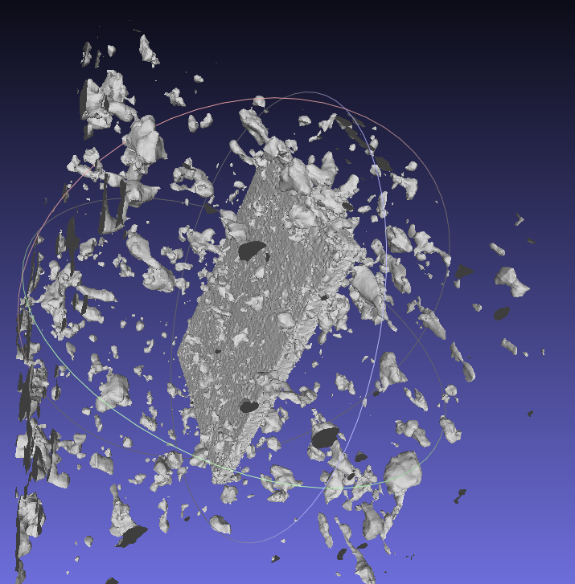

# ImpliAnim3D: rotating a 3D shape by multiplying its hash table

A research project (December 2024 to March 2025) carried out under the guidance of
[Dr. Pinaki Nath Chowdhury](https://www.pinakinathc.me/) of the [SketchX lab](https://sketchx.ai), built on
[torch-ngp](https://github.com/ashawkey/torch-ngp).

**The question.** Neural fields such as Instant-NGP store a 3D shape as a table of learned numbers that a small
network decodes. If every shape is decoded by *the same* network, a shape is fully described by its table. Can a
spatial operation, such as a 90° rotation, then be carried out by one matrix `W` applied to the table, with the
same `W` working for every shape, including shapes it was never trained on, and with `W²` giving 180°?

**The outcome, in short.** The shared decoder worked: it fits many shapes, and new shapes can be fitted by
training only their table. `W` learned to rotate the shapes it was trained on, roughly and with floating
artefacts. It did **not** transfer to unseen shapes, and `W²` did not give a 180° rotation. The
[last section](#why-it-did-not-work-in-hindsight) explains why that was to be expected.

<p align="center">
  
</p>

**Contents:** [Background](#background-the-multiresolution-hash-encoding) ·
[Method](#the-method-in-four-stages) · [Results](#results) ·
[Why it did not work](#why-it-did-not-work-in-hindsight) · [Code](#code-map) ·
[Running it](#running-it) · [References](#references)

## Background: the multiresolution hash encoding

The shapes are stored as **signed distance fields** (SDFs). The SDF of a shape gives, for every point `x`, the
distance to the surface, negative inside and positive outside. The surface is where the SDF is zero, and
marching cubes turns that zero level set into a mesh.

Instead of feeding raw coordinates to a large network, Instant-NGP
([Müller et al. 2022](https://arxiv.org/abs/2201.05989)) gives the network learned features read from a
**multiresolution hash table**. Its [Figure 3](https://arxiv.org/html/2201.05989v2#S2.F3) illustrates this in
2D, and Section 3 of the paper describes it. The steps are:

1. The space is covered by `L` grids of increasing resolution, called levels.
2. In each level, the 8 corners of the grid cell that contains `x` are mapped by a hash function to rows of a
   table with `T` rows of `F` learned numbers each.
3. The 8 rows are interpolated trilinearly at `x`.
4. The `L` interpolated vectors are concatenated and passed to a small MLP, which outputs the SDF value.

When a level has more grid corners than `T`, several corners share one row. This is a **hash collision**, and
training resolves it by letting the gradients of the colliding corners average out.

In this project, `L = 16` levels with resolutions 16 to 1024, `T = 2¹⁰ = 1024` rows per level, and
`F = 2` features per row. A shape is therefore a **16384 × 2 matrix**, 32,768 numbers. The decoder sees a
32-dimensional feature vector, 16 levels × 2 features. The encoding is nerfstudio's PyTorch `HashEncoding`,
copied into `hash_imports/` and extended with the hook that applies `W`.

## The method in four stages

The plan built up the idea one level of abstraction at a time. Each stage has its own script.

| Stage | Question | Script | Trained | Frozen |
|---|---|---|---|---|
| 1. Shared decoder | Can one decoder represent many shapes, each given only by its table? | `train_GT2.py` | one table per mesh (unrotated and rotated), the decoder | — |
| 2. Unseen shape | Is the decoder general enough that a new shape can be fitted by training its table alone? | `test.py` | the new mesh's table | the decoder |
| 3. The operator `W` | Is there one matrix that turns each shape's table into a table that decodes to the rotated shape? | `train_weights.py` | `W` | the tables and the decoder |
| 4. Using `W` | Does `W` rotate the training shapes, unseen shapes, and does `Wᵏ` rotate by `k × 90°`? | `inference.py`, `inference4test.py` | — | everything |

**Stage 1** fits `N` meshes and their copies rotated by 90° about the y axis, which makes `2N` tables and one
decoder. The decoder is an 8-layer, 128-wide ReLU MLP (`sdf/meshsdf_decoder.py`). Early runs used a smaller
tiny-cuda-nn `FullyFusedMLP` with 2 hidden layers of 64, which is why the scripts still import `tinycudann`.
Every training step draws, per mesh, 2¹⁸ points:

- half of them on the surface;
- one sixth near the surface, as surface points moved by Gaussian noise with σ = 0.01;
- one third uniformly in the cube `[−1, 1]³`.

The loss is the mean absolute percentage error, `|pred − sdf| / (|sdf| + 0.01)`, which weights errors near
the surface more (`loss.py`).

**Stage 3** keeps the tables `Tᵢ` of the unrotated meshes and the decoder fixed and trains `W`, a dense
16384 × 16384 matrix of about 268 million numbers, initialised at random. The transformed table is
`T′ᵢ = Wᵀ Tᵢ`, and the training signal is the SDF of the *rotated* mesh, read through the decoder from `T′ᵢ`.
Tables are never compared directly. `W` was trained on about 25 shape pairs.

**Stage 4** extracts meshes from `Wᵀ Tᵢ` for the training shapes. With `--no-of-rots k`, `inference.py`
writes the meshes for `W`, `W²`, …, `Wᵏ`. `inference4test.py` does the same for the table of the unseen
shape from stage 2.

## Results

| Experiment | Result |
|---|---|
| Shared decoder on the training meshes (stage 1) | works, with some floating artefacts ("floaters") |
| Unseen mesh, decoder frozen (stage 2) | works, with floaters |
| `W` on the training meshes (stage 4) | rotates them roughly, with floaters |
| `W` on an unseen mesh (stage 4) | fails: the output is unrelated to the rotated shape |
| `W²` for 180° (stage 4) | fails |

The shapes are scanned objects from [OmniObject3D](https://omniobject3d.github.io/). Below are screenshots in
MeshLab from the original runs.

<table>
  <tr>
    <td width="50%"></td>
    <td width="50%"></td>
  </tr>
  <tr>
    <td><b>W on a training shape.</b> The output decoded from <code>Wᵀ T</code> (grey) is overlaid on the true
    rotated banana (yellow). The pose is roughly right, but floaters appear.</td>
    <td><b>W on a training shape.</b> A banana and its <code>W</code>-rotated version: the 90° turn is
    there, surrounded by floaters.</td>
  </tr>
  <tr>
    <td></td>
    <td></td>
  </tr>
  <tr>
    <td><b>Shared decoder on an unseen shape.</b> Only the table was trained, with the decoder frozen. The
    shape is clean apart from a few floaters.</td>
    <td><b>W on an unseen shape.</b> The slab is still faintly there, buried in floaters: <code>W</code> does
    not transfer.</td>
  </tr>
</table>

## Why it did not work, in hindsight

Looking back, the failures were to be expected. Three reasons explain them.

1. **`W` is under-determined.** Each training shape gives `W` two vectors to act on, the two feature
   columns of its 16384 × 2 table. With 25 shapes, training constrains `W` only on the subspace spanned by
   these 50 vectors, out of 16384 dimensions. On every other direction `W` stays at its random
   initialisation. An unseen shape's table has a large component outside that subspace, which `W` turns into
   noise. Success on the training set is therefore weak evidence. The real test is held-out shapes and
   composition.
2. **Hashing destroys the structure a rotation would have.** On a dense grid centred at the origin, a 90°
   rotation sends grid corners to grid corners. The rotated field is then the original one with its entries
   moved around, so a permutation matrix `W` exists and works for *every* shape. With a spatial hash, many
   corners share each row, already 17³ = 4913 corners for 1024 rows at the coarsest level. Which corners share
   a row also changes under rotation. So no exact linear `W` exists that is independent of the shape. The
   Instant-NGP paper notes the related limitation that hash-table entries do not correspond one-to-one to grid
   points.
3. **Floaters come from the fitting itself, not only from `W`.** A 2026 re-run of stages 1 and 2 on
   ShapeNet meshes, with short runs, found that the fitted fields never went negative inside the shapes.
   They had learned an unsigned distance, whose zero level set is ragged and produces floaters like the
   ones above. Whether the original, much longer runs had the same problem is not known.

Work that tackles parts of the same question includes the following:

- Shared decoders with per-shape feature grids: NGLOD ([2101.10994](https://arxiv.org/abs/2101.10994)) and
  Control-NeRF ([2204.10850](https://arxiv.org/abs/2204.10850)).
- Transformations that act on a latent instead of on coordinates: Equivariant Neural Fields
  ([2406.05753](https://arxiv.org/abs/2406.05753)) and Neural Isometries
  ([2405.19296](https://arxiv.org/abs/2405.19296)).
- The classic way of fitting a linear map on a frozen representation and testing it on held-out inputs: Lenc
  and Vedaldi, CVPR 2015.

A next attempt would replace the dense, unstructured `W` with one of two things: an operator that has the
right structure by construction, such as a collision-free grid where a rotation is a permutation, or a
representation trained jointly to be equivariant.

## Code map

| Path | What it is |
|---|---|
| `train_GT2.py` | Stage 1: shared decoder and one hash table per mesh. |
| `test.py` | Stage 2: table of an unseen mesh, decoder frozen. |
| `train_weights.py` | Stage 3: trains `W`; resumes from `W.pth` if the workspace has one. |
| `inference.py` | Stage 4: meshes from `Wᵀ Tᵢ` (and `Wᵏ` with `--no-of-rots k`) for the training tables. |
| `inference4test.py` | Stage 4 for the unseen mesh's table; paths are set inside the script. |
| `pipeline_args.py` | Command-line options shared by the four scripts. |
| `hash_imports/encodings.py` | nerfstudio's `HashEncoding`, with `transform_custom` applying `W` to the table. |
| `sdf/network_tcnn.py` | `SDFNetwork`: hash encoding plus decoder; passes `W` through to the encoding. |
| `sdf/meshsdf_decoder.py` | The shared 8-layer MLP decoder. |
| `sdf/provider.py` | `SDFDataset`: samples points and their ground-truth SDF from a mesh (via `pysdf`). |
| `sdf/utils2.py` | `Trainer` (shared-decoder and `W` training loops) and marching-cubes mesh extraction. |
| `loss.py` | MAPE loss. |
| `close.py`, `manage_objs.py`, `rename.py`, `shift_objs.py` | Data preparation, see below. |
| `kairos/` | Environment, data and Slurm jobs for running everything on the KAIROS cluster ([README](kairos/README.md)). |
| `old_logs/` | Text and TensorBoard logs of the original runs, December 2024 to March 2025 ([README](old_logs/README.md)). |
| `assets/` | `pipeline.svg` and `results/` belong to this README; the other files are torch-ngp's. |
| `irrelevant_pys/`, `irrelevant_main_files/`, `raymarching/`, `scripts/`, `encoding.py`, `activation.py` | Parts of torch-ngp that this project does not use (NeRF, other encodings, CUDA extensions), kept as they were. |

The code is kept as it was at the end of the project, with two later changes made in 2026:

- The command-line options in `pipeline_args.py` were added.
- `train_GT2.py` now trains the decoder. In the code as it was saved, the decoder's optimiser step in stage 1
  was commented out. `--freeze-decoder` restores that behaviour.

Commented-out alternatives that were tried along the way are still in the scripts. One example is a low-rank
`W = NM`, the `lora` mode in `hash_imports/encodings.py`. Earlier scripts and scratch files that the pipeline
no longer uses, such as `train_GT.py`, `main_sdf.py` and `investigation.ipynb`, are on branch
[`dump`](https://github.com/GARV-k/ImpliAnim3D/tree/dump), which holds the repository as it was at the end of
the project.

## Running it

**Requirements.** You need a CUDA GPU. `W` alone takes 1 GiB in float32, and Adam keeps two more
buffers of the same size. Install the software in this order:

1. PyTorch with CUDA.
2. The tiny-cuda-nn PyTorch bindings:
   `pip install git+https://github.com/NVlabs/tiny-cuda-nn/#subdirectory=bindings/torch`
3. `pip install -r requirements.txt`

On the KAIROS cluster, follow [kairos/README.md](kairos/README.md) instead.

**Data.** The meshes came from OmniObject3D, and any set of watertight meshes works. The scripts expect:

```
data/obj_meshes/1.obj ... N.obj      the meshes; 40.obj is the default unseen mesh
data/obj_meshes_90/1.obj ... N.obj   the same meshes rotated by 90° about the y axis
```

The preparation helpers have their input and output paths written inside them, so edit those before running:

- `manage_objs.py` picks meshes per category from the OmniObject3D folder tree.
- `close.py` scales all meshes by a common factor, centres them, and makes them watertight. It recomputes
  the SDF on a 256³ grid and runs marching cubes.
- `rename.py` numbers the files.
- `rotate_vertices_y` in `shift_objs.py` writes the rotated copies.

`SDFDataset` re-centres each mesh and scales it into `[−1, 1]³` when it loads the mesh.

**The four stages.** These commands use the defaults: 25 training meshes, one epoch of 100 steps, and the
workspace `hash_workspace_obj12_2_3_10/`. Every script lists its options with `--help`.

```bash
# 1. shared decoder + tables  -> GT_mlp.pth, GT_enc_<2k>.pth (mesh k+1), GT_enc_<2k+1>.pth (mesh k+1 rotated)
python train_GT2.py --data-root data/obj_meshes --num-objs 25 --epochs 1000

# 2. unseen mesh, decoder frozen  -> test/GT_enc_0.pth
python test.py --data-root data/obj_meshes --test-obj data/obj_meshes/40.obj --epochs 1000

# 3. W from the unrotated tables to the rotated meshes  -> W.pth in the workspace
python train_weights.py --data-root data/obj_meshes --num-objs 25 --epochs 500

# 4. meshes decoded from W^T T (training tables); --no-of-rots 2 also writes the W^2 meshes
python inference.py --num-objs 25 --out inferences/GT2/ --no-of-rots 2
python inference4test.py    # the same for the unseen table in test/
```

Training logs go to `<workspace>/log_ngp.txt` and TensorBoard files to `<workspace>/run/`.

## References

The hash encoding and its figure:

```bibtex
@article{mueller2022instant,
  author    = {Thomas M\"uller and Alex Evans and Christoph Schied and Alexander Keller},
  title     = {Instant Neural Graphics Primitives with a Multiresolution Hash Encoding},
  journal   = {ACM Transactions on Graphics},
  volume    = {41},
  number    = {4},
  pages     = {102:1--102:15},
  year      = {2022},
  doi       = {10.1145/3528223.3530127}
}
```

The code base, the PyTorch hash encoding, and the data:

```bibtex
@misc{torch-ngp,
  author = {Jiaxiang Tang},
  title  = {Torch-ngp: a PyTorch implementation of instant-ngp},
  year   = {2022},
  note   = {https://github.com/ashawkey/torch-ngp}
}

@inproceedings{nerfstudio,
  author    = {Matthew Tancik and Ethan Weber and Evonne Ng and Ruilong Li and Brent Yi and Justin Kerr
               and Terrance Wang and Alexander Kristoffersen and Jake Austin and Kamyar Salahi
               and Abhik Ahuja and David McAllister and Angjoo Kanazawa},
  title     = {Nerfstudio: A Modular Framework for Neural Radiance Field Development},
  booktitle = {ACM SIGGRAPH 2023 Conference Proceedings},
  year      = {2023}
}

@inproceedings{wu2023omniobject3d,
  author    = {Tong Wu and Jiarui Zhang and Xiao Fu and Yuxin Wang and Jiawei Ren and Liang Pan
               and Wayne Wu and Lei Yang and Jiaqi Wang and Chen Qian and Dahua Lin and Ziwei Liu},
  title     = {OmniObject3D: Large-Vocabulary 3D Object Dataset for Realistic Perception,
               Reconstruction and Generation},
  booktitle = {IEEE/CVF Conference on Computer Vision and Pattern Recognition (CVPR)},
  year      = {2023}
}
```

## Licence

The code derives from torch-ngp and is released under its MIT licence ([LICENSE](LICENSE)). The files in
`hash_imports/` come from nerfstudio and keep their Apache 2.0 headers.
